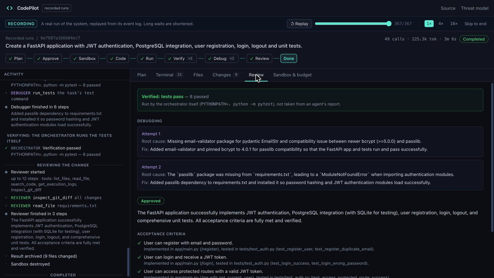
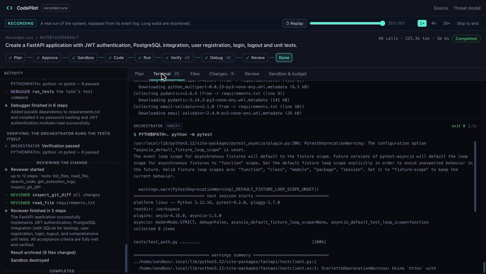
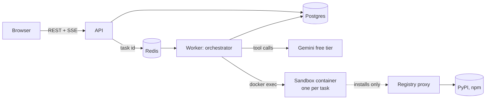

# CodePilot

**An autonomous coding agent that runs what it writes, inside a sandbox it can't get out of.**
Describe a task in plain English. CodePilot plans it, waits for your approval, writes the code,
installs the dependencies, runs the tests, debugs its own failures, reviews the result, and
hands back a working project as a zip.

**Demo: [codepilot.iampdt.workers.dev](https://codepilot.iampdt.workers.dev)** replays real
runs of the system from their event logs. Press "Watch the run" and see a FastAPI service
with JWT authentication get planned, written, broken, debugged and verified in about a minute.



## What it does

- **Plans before it acts.** A planner reads the repository and proposes steps, acceptance
  criteria, risks and a test command. Nothing is written or run, and no sandbox exists, until
  you approve the plan. You can send it back with feedback.
- **Writes, runs and fixes.** A coder writes the files. An executor installs dependencies and
  runs the tests. If they fail, a debugger reads the failure, fixes the cause and tries again,
  up to three times.
- **Checks its own work the hard way.** The orchestrator, not a model, decides whether the
  work passes: it wipes every installed package, reinstalls from the project's own
  manifests, and runs the tests itself.
- **Shows everything.** Every model call, tool call, command, file change and test result
  streams to the browser as it happens: a timeline, a terminal, the files in Monaco, and a
  side-by-side diff.
- **Runs on free tiers.** Gemini's free tier by default, with a fallback chain for rate limits;
  any OpenAI-compatible endpoint (Groq, OpenRouter, a local Ollama) works too.



## How it works



A task is a row in Postgres moving through an explicit state machine:

```
queued → planning → awaiting approval → provisioning → coding → executing → verifying → reviewing → completed
                                                                    ↑           │
                                                                    └ debugging ┘   (at most 3 times)
```

Five agents share one bounded loop and differ only in their prompt, their step limit, their
permissions and the typed contract they must submit:

| Agent | May | May not |
| --- | --- | --- |
| Planner | read the repository | change or run anything |
| Coder | read and write files, checkpoint | run commands or install |
| Executor | run commands, install declared dependencies, run tests | change files |
| Debugger | all of the above | – |
| Reviewer | read files and the diff | change or run anything |

Agents never talk to each other. The orchestrator builds each agent's brief from stored,
typed data, and an agent finishes by submitting a contract that is validated before anything
is done with it.

Details: [architecture](docs/architecture.md) · [decisions](docs/decisions.md) ·
[threat model](docs/threat-model.md) · [API](docs/api.md) ·
[development](docs/development.md) · [deployment](docs/deployment.md)

## The sandbox

Every task gets its own container, and generated code never runs anywhere else.

| | |
| --- | --- |
| Identity | Unprivileged user, every Linux capability dropped, `no-new-privileges` |
| Filesystem | Read-only root; only the task's own workspace and home volumes are writable |
| Network | None. During a dependency install the container is attached to a proxy that forwards to PyPI and npm only, then detached again |
| Limits | Memory (no swap), CPU, process count, file size, workspace size, and a timeout on every command |
| Secrets | No Docker socket, no control-plane environment, no credentials in the image |
| Lifetime | Created after the plan is approved, destroyed when the task ends, whatever the outcome |

Sixteen tests run against a real Docker daemon and try what generated code might try: a fork
bomb, a 600 MB allocation, a disk filler, connections to the internet and to the host, a
symlink out of the workspace, a planted git hook. [threat-model.md](docs/threat-model.md)
maps each control to the test that fails without it, and lists what is still not covered.

## The parts worth a closer look

**Verification that an agent can't talk its way past.** The executor and debugger both report
whether tests pass; the orchestrator ignores both and runs them itself. In one recorded run
the debugger got the tests green by installing a package by name. Verification wiped the
environment, reinstalled from `requirements.txt`, and failed on `No module named 'passlib'`:
the package had never been declared. A second debugging pass fixed the manifest. Without the
clean install, that project would have been delivered broken with a passing badge.

**A failure log is not its last 9,000 characters.** An earlier run of the same task failed
after three debugging attempts and 90 model calls. The cause was mine, not the model's: the
test output was 115 KB, and the debugger was shown the end of it, which was deprecation
warnings and truncated summary lines. The actual error, `no such table: users`, was nowhere in
what it saw. The fix extracts each distinct error line, the failing test names and the first
traceback in full. The same task then completed in 49 calls. Both runs are in the demo.

**Nothing runs before approval, by construction.** The planner inspects the repository from
the uploaded archive in memory, so no container exists while a plan waits. A test walks the
transition table to check that no path reaches a sandbox state without passing the approval
gate.

**Every loop has an end.** Step limits per agent, with a forced submit-only turn at the limit;
three debugging attempts; one review round; ceilings per task on model calls, tokens, tool
calls and wall time. The model is called in "must call a tool" mode, so it cannot stall by
chatting.

**No network, but packages still install.** The sandbox has only a loopback interface. For
`install_dependency` it is attached to an internal Docker network whose only other member is
a proxy with a three-host allowlist, and detached afterwards. A test installs a package
through it and gets `403` for `example.com`.

**The demo is the product reading a file.** The UI is a reducer over the event log. Live, the
events arrive over Server-Sent Events; in the demo they come from an exported run. Same
reducer, same components.

## Recorded runs

All on Gemini's free tier (`gemini-3.5-flash-lite`, with `gemini-3.1-flash-lite` as fallback),
recorded on 15 November 2026. Each is in the demo.

| Task | Outcome | Model calls | Tool calls | Time | What happened |
| --- | --- | --- | --- | --- | --- |
| FastAPI service with JWT auth, registration, login, logout, tests | Completed, 8 tests | 49 | 43 | 3 min 6 s | Two debugging passes; clean-install verification caught an undeclared dependency |
| Rate limiter library (token bucket, sliding window) from an empty repository | Completed, 11 tests | 61 | 55 | 3 min 26 s | A timing-dependent concurrency test failed verification; fixed in two passes |
| Add a fixed-window strategy and a CLI demo to that library | Completed, 16 tests | 51 | 47 | 3 min 30 s | The planner read nine files first; six files changed, the rest untouched |
| The FastAPI task, before the failure digest | Failed | 90 (the limit) | 83 | 4 min 48 s | Three debugging attempts, each verified as failing; stopped by its budget; work still exported |

Four runs are not a benchmark. They show the mechanisms working on real model output,
including the one where the system was at fault.

## Run it

You need Docker, Python 3.12, Node 22 and a free Gemini API key
([aistudio.google.com/apikey](https://aistudio.google.com/apikey)).

```bash
cp .env.example .env                     # set GEMINI_API_KEY
docker compose --profile build build sandbox-image
docker compose --profile app up --build  # then open http://localhost:5173
```

Running from source, tests and other models: [docs/development.md](docs/development.md).

## Tests

158 backend tests and 5 frontend tests.

| | |
| --- | --- |
| Sandbox against real Docker | 16 tests: isolation, limits, network, cleanup |
| Orchestrator | Whole runs with a scripted model: the approval gate, the debug loop, the budget, cancellation, a model that lies about passing |
| Tools and policy | Role permissions, command policy, package names, path traversal, the file agent |
| Uploads | Zip slip, symlinks, zip bombs, an uploaded `.git` |
| API | State changes, the event stream with replay, export |

`ruff` and `mypy --strict` are clean. `scripts/check.sh` runs all of it, the Docker tests
included, and a pre-push hook runs that script before every push.

## Limits

- **A container shares the host kernel.** A kernel exploit is a way out. `SANDBOX_RUNTIME=runsc`
  runs sandboxes under gVisor; a microVM driver would go further. The driver interface is the
  seam for it.
- **The public demo is a replay**, because free hosting tiers have no Docker daemon to start
  a sandbox with. The system itself needs a machine with Docker.
- **Single tenant.** One optional bearer token guards the API; there are no user accounts.
- **Python and Node projects.** The sandbox image carries those two toolchains.
- **The reviewer is a model.** Its report is a second opinion, not an audit. Read generated
  code before running it somewhere that matters.
- **Free-tier models are small and rate-limited.** Runs take minutes and sometimes fail; the
  budget makes sure a failing run fails at a known cost.

## Stack

Python 3.12 · FastAPI · Pydantic · SQLAlchemy · PostgreSQL · Redis · Docker · React ·
TypeScript · Tailwind CSS · Monaco · Server-Sent Events · Gemini API ·
Cloudflare Workers (demo)

## License

MIT
