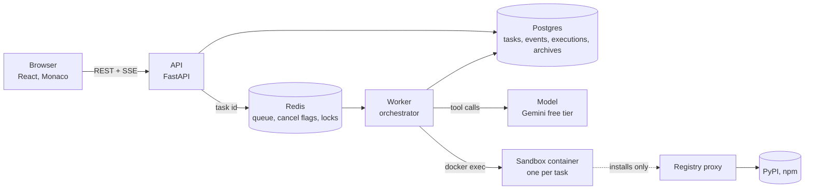
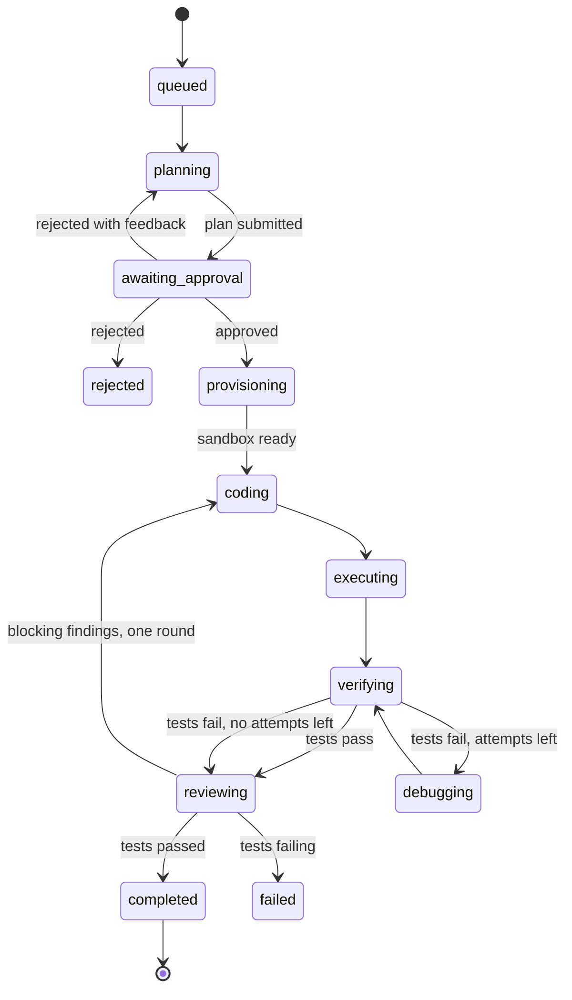

# Architecture

## The shape



Three kinds of process:

- **API** validates requests, reads and writes task state, and puts task ids on a queue. It
  never runs an agent or a command.
- **Worker** takes a task id, runs the orchestrator for it, and owns that task's sandbox. By
  default it runs inside the API process (`RUN_WORKER_IN_API=true`); `python -m
  app.worker_main` runs it separately.
- **Sandbox** is a container that exists for one task. See [threat-model.md](threat-model.md).

## A task, start to finish



Every state can also go to `failed` (budget, model or sandbox error) or `cancelled`.

The table of allowed transitions is `backend/app/orchestrator/state.py`. Each state has one
handler in `machine.py`; a handler returns the next state and `_transition` refuses any move
the table doesn't list. The update is a compare-and-set (`UPDATE … WHERE state = :current`), so
when the API cancels a task the worker's next transition matches no row and the run stops.

Two properties come from the table rather than from code that could be forgotten:

- **Nothing runs before approval.** There is no edge from `queued` or `planning` to any state
  with a sandbox except through `awaiting_approval` (a test walks the graph to check).
- **Every loop is bounded.** `debugging ↔ verifying` is limited by `MAX_DEBUG_ITERATIONS`,
  `reviewing → coding` by `MAX_REVIEW_ROUNDS`, `awaiting_approval → planning` by
  `MAX_PLAN_REVISIONS`.

### Waiting costs nothing

While a plan waits for approval, no worker, model call or container is held. The task is a row
in Postgres in state `awaiting_approval`. Approving it flips the state and queues the id; any
worker picks it up. The planner inspects the repository through `ArchiveWorkspace`, which
serves `list_files`, `read_file` and `search_code` from the zip in memory, so the first
container is created only after approval.

### After a crash

A worker holds a Redis lock per task and refreshes it. When a worker starts it looks for tasks
in an active state with no lock: one that was still planning or provisioning is queued again
(nothing is lost); one that was further along has lost its sandbox and is marked failed.
Containers and volumes whose task is no longer running are removed.

## Agents

There is one agent loop (`agents/base.py`) and five configurations of it
(`agents/roles.py`). A configuration is a role, a system prompt, a step limit and the contract
the agent must submit.

| Agent | Can | Cannot | Submits |
| --- | --- | --- | --- |
| Planner | read the repository | change or run anything | `Plan`: steps, acceptance criteria, risks, dependencies, test command |
| Coder | read, write, edit, delete, checkpoint, view the diff | run commands, install | `CodingReport` |
| Executor | read, run commands, install, run tests, read logs | change files | `ExecutionReport` |
| Debugger | everything above | – | `DebugReport`: root cause, fix, files |
| Reviewer | read, view the diff, read logs | change or run anything | `ReviewReport`: verdict, criteria, findings |

The permissions are a table in `tools/registry.py`, enforced on every call, not a matter of
which tools the prompt mentions. An agent that calls a tool outside its role gets
`permission_denied` back as a tool result.

### How agents communicate

They don't. The orchestrator builds each agent's brief in code from stored, typed data: the
task, the plan, earlier reports, the observed test output. An agent ends by calling its submit
tool; the arguments are validated against a Pydantic model, and a result that doesn't validate
goes back to the agent as an error to correct. What an agent wrote in passing is shown in the
UI and goes nowhere else.

### How a loop ends

1. The agent submits a valid contract.
2. It reaches its step limit: three steps before, it is told; at the limit the only tool
   offered is the submit tool, for at most two turns.
3. The task's budget runs out, or the task is cancelled.

There is no fourth way. The model is called in "must call a tool" mode, so a turn of prose is
not a possible answer.

### Context

Each turn resends the conversation, so cost grows with the square of its length. Before each
call, tool arguments and results more than eight messages back are replaced with a stub
(`[4,210 characters elided]`); the brief and recent turns stay whole. An agent that needs an
old file reads it again.

## Verification

The executor and the debugger both report whether tests pass. The orchestrator ignores both.
In `verifying` it does two things itself, through the same tool layer:

1. **Clean install.** It deletes every package installed in the sandbox so far and installs
   again from the project's own manifests (`requirements*.txt`, `package.json`). A package an
   agent installed by hand but never declared is gone at this point.
2. **Tests.** It runs the test command, and the exit code decides the next state.

So "tests pass" means they pass for someone who downloads the result and installs what it
declares, not merely in the environment the agents happened to build up. The command must be a recognised test runner (`pytest`, `python -m
unittest`, `npm test`, `npx vitest`, `npx jest`, `node --test`), so an agent can't nominate
`true`. If the tests still fail after the last debugging attempt, the work is reviewed and
exported anyway and the task ends as `failed`.

## Tools

Thirteen tools. Each call goes through the same steps in `tools/registry.py::invoke`:

1. **Permission:** the role must hold the tool's permission.
2. **Validation:** arguments are parsed into the tool's Pydantic input model (`extra="forbid"`).
3. **Budget:** the call is charged; a task past its tool budget ends.
4. **Execution:** under a timeout, against the sandbox only.
5. **Record:** an event with the agent, tool, arguments (long strings cut), outcome and duration.

A refusal at steps 1, 2 or 4 is returned to the model as `{"ok": false, "error": {"code",
"message"}}`.

File tools don't touch files from the control plane. Each is a `docker exec` of
`sandbox/image/agentd.py` inside the container, as the sandbox user, with a JSON request on
stdin. The control plane checks the path's syntax; the file agent resolves symlinks and checks
that the real path is inside `/workspace`.

Checkpoints are commits in a git repository inside the workspace. `restore_checkpoint` accepts
only ids that the same task created. The repository's own index is never used by the API's
live diff, which stages into a separate index file so it can't collide with a checkpoint.

## Events

Everything a run does is an event: state changes, model calls with token counts, tool calls,
command output, test results, checkpoints. `EventBus.emit` writes the row to Postgres, then
publishes on a Redis channel.

The browser follows `GET /api/tasks/{id}/stream` (Server-Sent Events). The handler reads
events from Postgres after the client's last id, and uses Redis only as a wake-up signal. A
client that reconnects sends `Last-Event-ID` and misses nothing; a lost Redis message delays an
event by at most one keep-alive interval.

The UI is a reducer over this log (`frontend/src/lib/reduce.ts`). A recorded run in the public
demo is the same log read from a file, through the same reducer.

## Model layer

`llm/base.py` defines provider-neutral messages. `GeminiProvider` speaks Gemini's REST API and
stores each model turn exactly as received, because the API expects it back unchanged.
`OpenAICompatProvider` covers Groq, OpenRouter and a local Ollama.

`ModelRouter` holds a chain of models. Each round tries every model once; a rate limit, outage
or malformed answer moves to the next. If the whole chain is unavailable the router waits (the
provider's own retry hint when there is one) and tries again, up to four rounds. The wait is
visible in the UI.

## Data

| Table | Holds |
| --- | --- |
| `projects` | Name and description |
| `tasks` | State, plan, the agents' reports, usage, counters, the observed test result, the final diff and changed files |
| `events` | The append-only log of each run |
| `executions` | Every command with its exit code, duration and output |
| `artifacts` | Zip archives: uploads and results |

Archives live in Postgres so results survive on hosts without a persistent disk. A new task in
a project starts from the result of the project's last completed task.

## Code map

```
backend/app/
  orchestrator/  state.py (transitions) · machine.py (handlers) · budget.py
  agents/        base.py (the loop) · roles.py (prompts, briefs) · contracts.py
  tools/         registry.py (13 tools, permissions, invoke)
  sandbox/       base.py (interface) · docker_driver.py · policy.py · archive.py · git.py
  llm/           base.py · gemini.py · openai_compat.py · router.py
  api/           routes.py · deps.py
  events.py · worker.py · models.py · config.py
sandbox/image/   Dockerfile · agentd.py (the file agent inside every sandbox)
sandbox/egress-proxy/   tinyproxy with a three-host allowlist
frontend/src/    lib/reduce.ts (events → screen) · lib/useRun.ts · pages · components
```
